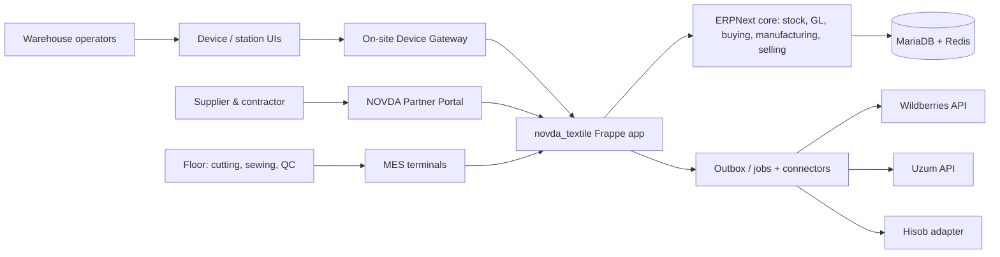

# 02 — Target Architecture / qarorlar
## C4 Context (logical)

## Bounded contexts
1. **ERPNext core**: Company, Chart of Accounts, Item/variants/UOM, Supplier/Customer, RFQ/PO, Purchase Receipt, Batch/Serial where justified, Stock Entry/Delivery Note, Work Order/BOM/Job Card, Subcontracting, invoices, GL, cost centers. **Backend of record.**
2. **`novda_textile`**: supplier roll declaration/ASN, Roll/Remnant IDs, bundle genealogy, shop-floor operation evidence, QC deviation, custom dashboard/WMS bins, packaging hierarchy, print job, integration inbox/outbox and transaction commands. All write ERP stock through ERPNext submitted documents/API.
3. **Device gateway (edge)**: vendor-specific scale serial/TCP adapter, measurement stabilization, 2D scan validation, label spool/reprint evidence, store-and-forward, device heartbeat. Local outbox only, not an authoritative stock ledger.
4. **Integrations**: WB/Uzum typed adapters, settlement ingestion, virtual marketplace snapshots + reconciliation; Hisob adapter, optional e-document provider. Every integration has replay-safe import and non-destructive reconciliation.
5. **Security/control**: partner separation enforced server-side, least privilege, two-person approval for sensitive financial/inventory adjustment; immutable event/audit; vault secrets, backup and DR.

## Hard invariants
- Mutating physical stock only by native ERPNext submitted stock documents, never by ledger.json/custom raw quantity writes.
- No duplicate inventory/GL ledger in custom app. MES physical quantity and ERP stock reconcile at explicit accounting checkpoints.
- `SupplierDeclaredNet`, `ReceivedScaleNet`, `AcceptedNet`, `InvoicedQty` always distinct.
- Item-SKU, Lot/Batch, Roll, Bundle, Carton, HU, Shipment, External Barcode, GTIN, KIZ all different dimensions/identities; mapping not overwriting.
- All posting commands have actor, tenant/site, source doc, idempotency key, expected revision and preconditions; failures leave business state unchanged.
- No silent negative stock, SKU cross-contamination, rate retroactivity, unapproved adjustment; corrections via reference-linked reversals.
- Outbox writes in same DB transaction as internal event, external side-effects retried idempotently.
- Unit-specific measurement (kg, m, piece, roll, package); **never blanket kg↔metre conversion**.
- Quality blocked goods not available-to-promise. WIP cannot be counted as finished sellable inventory.
- Partner-owned, NOVDA-owned, and buyer-owned stock tracked separately incl. owner vs custodian.

## Infrastructure baseline
- Windows workstation: Docker Desktop + WSL2 or devcontainer; no host production secrets.
- Frappe/ERPNext **pinned and compatible** version branch; prefer v16 if stable and compatible in live install, otherwise v15. Record exact tag/sha and used feature availability. ERPNext **MariaDB**, Redis; production deployment separate with immutable app image and versioned DB migration.
- Dev/test/pilot/prod with distinct URLs/DB/secrets and no automatic live push.

## ADRs (first decisions)
`ADR-001`: extend ERPNext, no bespoke ERP replacement. `ADR-002`: custom app may extend but not fork framework. `ADR-003`: weight as evidence; stock after validation. `ADR-004`: supplier QR server-issued; alias existing supplier QR. `ADR-005`: append-only event+canonical ERP posting. `ADR-006`: device print after commit; print failure not inventory failure. `ADR-007`: strict DB+role isolation for partners. `ADR-008`: stage gates before unattended next phase. `ADR-009`: no live external writes until pilots.

## Architectural anti-patterns — forbidden
JSON file as primary warehouse datastore, UI-only fake numbers, backend that never calls ERPNext, one generic table for all documents, blanket `db.set_value` stock manipulation, dynamic exec of vendor-provided scan code, company/vendor filtering only in frontend, E2E pass based only on HTTP health endpoint, repo containing real tokens, blind retries of stock/finance documents.
