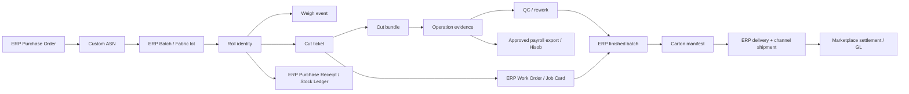

# 05 — Domain model va integratsiya chegaralari
To‘liq 43 ta entity ro‘yxati `05_DATA_DICTIONARY.csv` da. **Logical ERD**:

## Ma’lumot integriteti
1. Global IDs immutable, display ID separate. UUID/internal PK; externally readable `R-YY-NNNNN`, `BND-...` only for human scan. No mutable quantity in QR payload.
2. `ERP Item` (commercial/material identity) vs `Batch` (stock grouping) vs `Roll` (physical unit) vs ERPNext `Serial and Batch Bundle` (transaction grouping) vs `CutBundle` (physical cut parts) — physically and logically **five different concepts**.
3. Roll physical weights are evidence; authoritative warehouse balance uses ERP stock ledger linked through receiving/picking/cutting transactions.
4. Every movement references `company,site,warehouse,owner,custodian,actor,reason,source_doc,quality_state`, plus idempotency key.
5. For fabric: store supplier-declared gross/tare/net, own-scale gross/tare/net, QC accepted net, invoiced qty; may all differ. Round only once at posting by selected UOM precision policy.
6. Split/merge genealogy permits 1→N with mass balance, N→M for cut parts with unit-specific formula; no simply adding kg to piece.
7. Model/size/color/pack compositions revision-controlled. Once a WO begins, fix its BOM, marker, rate and operation route revisions; later changes via explicit change order.
8. Party-owned customer stock in subcontract inward must never appear as NOVDA-owned asset by accident.
9. ERPNext `Serial and Batch Bundle` is recreated per transaction when required. Its name **not** reused as long-lived physical bundle ID.
10. Every event object has immutable event_id, event_time, recorded_at, actor/source/device, payload hash, processing status, idempotency key and evidence refs; store locally when offline, reconciled centrally later.
## Indexes and uniqueness
`roll_id UNIQUE`, `(supplier_id,supplier_roll_ref) UNIQUE` when provided, `(integration,account,external_event_id) UNIQUE`, `(station,idempotency_key) UNIQUE`, `(channel,account,external_sku) UNIQUE`, `label_print(job_id,attempt)`; immutable rate revisions. All server-side auth scoped to legal entity and partner.
## Numerics
DECIMAL for quantities/currency, all money with currency, effective FX date, UOM and rounding policy. Avoid floats for ledger. No automatic conversion kg↔m based on nominal GSM unless tested as clearly estimated only.

## Fizik rulon miqdorini ERP ledger bilan bog‘lash — boshlang‘ich yechim
Tanlangan **dastlabki gipoteza**: matoning har bir fizik ruloniga ERPNext ichida alohida `Batch` ID bog‘lash va haqiqiy kg qoldig‘ini native stock ledger tranzaksiyalarida shu batch bo‘yicha yuritish. Supplier/dye lot esa alohida `FabricLot` guruhlash konsepti bo‘ladi. Serial No (bir dona) kg bo‘yicha qisman sarf uchun mos bo‘lmasligi mumkin. `Roll` custom obyekt batchga 1:1 yoki nazoratli split genealogiyasi bilan ulanadi.

Gate B/C da ERPNext v15/v16 ning **Serial and Batch Bundle** tranzaksiyalari bilan Purchase Receipt, roll yarim sarf, remnant split, qaytim va WO sarfni amalda tekshiring. Agar batch-per-roll performance/valuation yoki boshqa native cheklovlar sabab noto‘g‘ri bo‘lsa, auditlangan `Inventory Dimension` yoki native alternative uchun alohida ADR yozing. Hech qachon parallel `roll.current_kg` ustunini *mustaqil accounting truth* sifatida ishlatmang.
