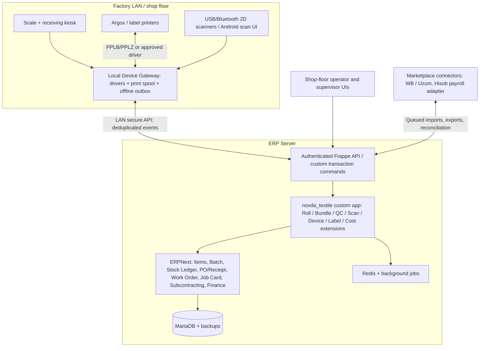
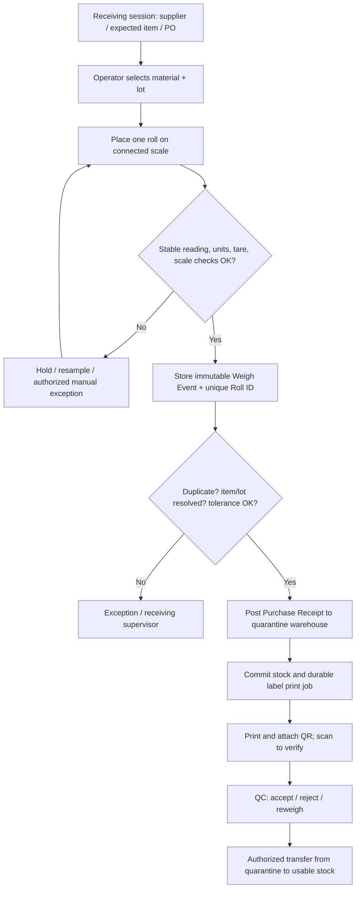

# NOVDA ERP — Architecture & Process Blueprint v0.1

**Status:** Design proposal, not approved implementation specification.  
**Date:** 2026-10-11  
**Platform:** ERPNext / Frappe + isolated `novda_textile` custom app + local device gateway.  
**Priority:** Plan processes, identities, transaction invariants, machine integration, and acceptance tests **before code generation**.

## 0. Purpose and scope

An end-to-end, auditable chain from fabric received on a physical scale to cut bundles, sewing operations, outsourced work, quality inspection, packed product, and marketplace shipment. Track **physical units**, **business documents**, **monetary costs**, **staff and devices**, and **traceability genealogy**. Do not create a duplicate ERP or duplicate stock ledger. This document is a proposed architecture; the actual device make/model/protocol and workflow tolerances must be validated on site.

Known context: NOVDA apparel/knitwear factory (T-shirts, long sleeves, polos, etc.); 200+ workers; multi-size/multi-color finished goods; subcontract operations; Wildberries and Uzum sales. Existing workers submit work, a supervisor validates it, and accounting currently uses Excel; an existing Hisob project exists. Argox iX4-350 printer was previously mentioned. No scale model, physical receiving station layout, or detailed cutting-bundle size rules have been verified.

## 1. Non-negotiable architecture rules

1. **Single inventory accounting source:** ERPNext's submitted Stock Entry / Purchase Receipt / Delivery Note / Subcontracting records and immutable stock ledger. Custom tables carry physical identity and evidence, not independent monetary stock balances.
2. **Physical identity != SKU != supplier lot:** supplier/dye lot contains many rolls; every roll gets a unique Roll ID; cutting yields Bundle IDs; packing yields Carton IDs; every finished variant has a SKU. IDs are not interchangeable.
3. **Reading a QR only identifies a physical unit.** An operation with an authorized user, target, document and validated quantity changes stock or work status.
4. **Weight readings are evidence; they are not stock movements.** Stock is posted only after a stable calibrated weight, resolved item, lot, tare, anti-duplicate check and authorized receipt rule.
5. **Print after commit:** completed receipts create a durable print job; printer failure cannot create double stock receipts. Reprints are logged.
6. **Every quantity change is traceable and reversible through an authorized compensating document; never delete stock history.**
7. **Production cost and piecework compensation require an approved version of BOM/rate and verified output.** A scan alone never pays a worker.
8. **Device loss or network interruption must not silently corrupt totals.** Queue scans/measurements locally with unique event IDs and controlled sync; no blind replay.
9. **No production credentials in agents. No direct live data edits by autonomous development agents.**

## 2. Logical system architecture



**Implementation boundaries:** ERPNext standard objects are always the first choice; custom `novda_textile` object adds missing garment-floor detail and device abstraction. Do not directly edit Frappe/ERPNext core. Pin tested Frappe/ERPNext versions and review migrations. ERPNext's typical database is **MariaDB**; do not force PostgreSQL for this deployment.

**Device gateway:** an on-site service connects to actual scale protocol (RS-232/USB virtual COM/TCP, device-specific), scans and printers, normalizes measurements and keeps a write-ahead outbox. It never independently adjusts ERP stock.

## 3. Canonical identities and data model

| Entity | Example ID | Purpose and critical fields | Record owner |
|---|---|---|---|
| Item / Material SKU | FAB-COT-160-WHT | Fabric type, composition, width, nominal GSM, Stock UOM kg | ERPNext Item |
| Supplier / dye lot | LOT-2026-104 | Supplier, mill lot, color, fabric specs, purchase order | ERPNext Batch field or custom `Fabric Lot` association |
| Physical roll | R-26-000183 | Unique roll, linked lot and batch, initial/current physical state, source parent, last measurement | Custom Roll + ERPNext batch stock |
| Weigh event | W-26-000500 | Scale ID, raw stable value, tare, net, unit, timestamp, operator, hash, measurement status | Custom immutable Weigh Event |
| Receipt / movement | PR-... / STE-... | Formal quantities, valuation, warehouses, references | ERPNext |
| Production order | WO-... | Model, color, size mix, BOM version, plan quantities | ERPNext Work Order + custom plan |
| Cut bundle | B-26-000812 | Source rolls, model, size, color, cut part count, target operation, current state | Custom Bundle + genealogy |
| Worker operation | OP-26-... | Bundle, job/operation, employee, submitted qty, verified qty, price version | Job Card + custom piecework event |
| QC event | QC-... | Inspected qty, good / rework / defect / scrap, reason, inspector | ERPNext Quality Inspection + custom details |
| Carton / bag | C-26-000043 | Contents by SKU/batch/qty, weight, sealing, shipping destination | Custom logistic unit + ERPNext Delivery Note |
| Marketplace listing mapping | MP-SKU-... | Internal SKU ↔ marketplace SKU/nmId, warehouse, fulfillment type | Custom connector |
| Label / print job | LP-26-... | ID, template version, printer, status, attempt and reprint audit | Custom label service |

**Important roll model decision:** use **kg as fabric Stock UOM**, **ERPNext Batch per physical roll** (allow variable kg) and **supplier/dye lot as a grouping attribute**. Link each custom Roll to its batch and current physical lifecycle. This avoids mapping a variable-weight roll to Serial No (serials typically represent individual stock units). Confirm partial depletion, split/repack, returns, batch reservation and performance with a prototype against the selected ERPNext version before freezing this design. Roll labels show a stable ID; **the weight shown on a label is the weight at print time**, while scanned live weight is queried from the server.

### Identity and genealogy constraints

- One Roll ID is never reused. A split creates child Roll IDs and links to a parent; it does not create fabric mass.
- A bundle may have **more than one contributing source roll**; persist exact source quantities/allocations.
- Parent-child genealogy supports forward trace (bad raw lot → affected bundles/finished cartons) and backward trace (sold SKU/carton → bundles → fabric rolls).
- Internal QR/Code128, GS1 product GTIN, Wildberries/marketplace label, and regulated DataMatrix codes are **separate identities**. An internal QR must not be passed off as a marketplace or mandatory regulatory code.

## 4. Weigh-to-receive flow (proposed)



**Decision:** use **automatic quarantine receipt** once the scale result and supplier/item context are validated. Make QC acceptance a separate release; uninspected fabric must not be cut. No unconditional receipt purely from scale weight. Each weigh event is evidence and can be associated with only one active posted receipt line; repeated scale packets are not repeated receipts. If the printer fails, receipt stays recorded with `LABEL_PENDING`; warehouse staff can reprint without duplicate stock. If weight is under/over tolerance, mark `REVIEW_REQUIRED`; no auto-post until supervisor resolves.

**Weight fields:** `gross_kg`, `tare_kg`, `net_kg = gross - tare`, `scale_id`, `stable`, `calibration_status`, `read_at`, `operator_id`, `resolution`, `reading_id`, `source_protocol`. Keep supplier declared weight separate from measured net; record tolerance by material/vendor. Derived theoretical meter length from GSM and width is **advisory**, not a substitute for actual measured length.

## 5. Core process maps

### A. Stock transfer / picking
Scan roll → identify current approved state and location → select transfer order + destination → scan location label → weigh partial issue if necessary → ERPNext Stock Entry / Batch bundle → update roll state and genealogy → record actor/time. Simply scanning must not issue inventory.

### B. Cutting and leftovers
Work Order + BOM and cutting plan → reserve approved fabric rolls by kg/batch → issue/transfer to WIP → scan Roll and Work Order → actual kg consumed logged; cut bundles created for size/color/part count → print per-bundle QR → reconcile useful outputs, cutting scrap, remnants and measured variance → usable remnant remains original Roll ID if same physical roll; newly separated remnants get child IDs and labels; create the necessary native stock movement/repack documents. Supervisor handles over-tolerance loss. Do not estimate fabric consumption by number of pieces only.

### C. Sewing, piecework and QC
Scan Bundle at operation station → read route and allowed next step → worker reports completed qty → foreman approves/corrects → approved accepted qty posted against Job Card / operation ledger → use effective piece-rate version for compensation → QC splits accepted, rework, reject and scrap → rework route retains original bundle genealogy and must not double-count wages or finished goods. Existing Hisob payroll consumes **approved summaries only**, not raw unapproved entries.

### D. Subcontract (usluga)
Create subcontract service and supplier warehouse → scan outgoing bundles/materials into a formal Subcontracting Order and Stock Entry → capture shipment ID, supplier, expected returns and price → receive partial finished goods with scan/inspection → post Subcontracting Receipt, wastage/rework/reject → reconcile supplier-held items, disputed discrepancies and payable services. Never treat materials physically held by a contractor as completely consumed before receipt/reconciliation.

### E. Packaging and marketplace dispatch
Complete QC → create finished SKUs by model/color/size and finished lot → scan to pack cartons containing one or multiple SKUs → count units, print carton QR, weigh carton for logistics check → reserve by sales/FBO shipment → pick/verify scans → ERPNext outbound document → asynchronous WB/Uzum shipment and stock mapping → external acknowledgement/reconciliation → returns receive into quarantine with reason and QC. Marketplace inventory and accounting states may differ; preserve `on_hand`, `reserved`, `packed`, `shipped`, `in_transit`, `marketplace_received`, `available_to_sell` distinctly.

## 6. Hardware integration contract

**Scale:** exact model and port settings must be physically inspected. Candidate adapters: serial RS-232, USB virtual COM, TCP/IP, Modbus/industrial protocols when device supports them. Read manufacturer-specific framing and stable flags; do not parse the last random number seen on the port. Gate each measurement on: scale online, stability indication or configurable stability window, valid tare, known unit, non-negative net, calibration check, fresh sequence / read ID, repeat-packet deduplication.

**Scanner:** prefer reliable 2D HID/USB scanner, Android camera as alternate. The browser/mobile app performs context-aware scanning through a single `resolve_label` function. Each stock-changing command includes user, workstation, location, target document, quantity, and idempotency key.

**Label printer:** Argox iX4-350 supports QR, DataMatrix, PPLA/PPLB/PPLZ emulation, and Ethernet/USB/RS-232. Choose the *actual installed* emulation (PPLB previously used), driver and label size based on a physical print/scan proof. Do **not** assume Argox directly accepts ESC/POS; choose printer-native output or a tested OS spool/driver. Printer jobs are outbox events with retry/reprint audit.

**Sample 58×40 mm internal roll label layout (final size to test):**

```text
┌─────────────────────────────┐
│ NOVDA • MATO / FABRIC       │
│ ███████████   R-26-000183   │
│ ██ QR CODE ██ LOT-2026-104  │
│ ███████████   Cotton White  │
│ Net: 23.420 kg  W: 180 cm   │
│ Status: QC HOLD             │
└─────────────────────────────┘
```

Encode only a durable ID such as `NVD:R:26:000183` (with validation/versioning), not editable kilograms/status. Printed weight/status may become stale and should be clearly dated or replaced after material movement.

### Normalized measurement event example

```json
{
  "event_id": "device-01:000029391",
  "station_id": "RECEIVING-01",
  "scale_id": "SCALE-01",
  "captured_at": "2026-10-11T09:12:44+05:00",
  "gross_kg": "24.100",
  "tare_kg": "0.680",
  "net_kg": "23.420",
  "stable": true,
  "calibration_ok": true,
  "protocol": "device-specific",
  "raw_packet_hash": "sha256-...",
  "receipt_session_id": "IN-2026-00012"
}
```

This is an **interface design example**, not a real scale reading or guarantee that a specific scale supports the fields.

## 7. Data integrity, availability, auditing

- **Atomic post:** one authorized operation triggers a native ERP transaction and one evidence link in a DB transaction. Labels and notifications are dispatched *after commit* via outbox/background workers.
- **Idempotency:** `event_id`, `command_id`, `(station, device_sequence)` unique keys. A replay returns previous result; never counts again.
- **Concurrency:** prevent two operators from issuing the same remaining roll kg; transaction-level validations/locking and version check.
- **Offline:** kiosk captures scans/weights with signed event IDs; critical final stock postings are **not assumed complete until server confirmation**. If offline, label indicates provisional/hold; ensure physical quarantine. Reconnect sync resolves ordering and conflicts.
- **Immutable audit:** corrections through reversal/adjustment documents with reason, actor, original event reference; restricted roles, immutable log, backups and restoration tests.
- **Security:** TLS or authenticated LAN tunnel, device-specific keys and RBAC; printer/scales not exposed on Internet. Never grant an overnight coding agent real money, payroll, marketplace write or production permissions.
- **Reconciliation:** `sum(roll batch qty by warehouse) == ERP stock balances` for tracked fabric; `cut accepted + scrap + leftovers == issued` within measured/defined tolerances; `received bundles - defect/rework/loss == accepted output` by operation; `carton contents == dispatch pick list`; no duplicate outward.

## 8. Workstations and roles

| Station | UI primary action | Role | Machine |
|---|---|---|---|
| Receiving | supplier / fabric / lot → weigh → quarantine receipt → print | receiving operator | scale, 2D scanner, Argox |
| QC arrival | inspect sample, accept/reject lot, quarantine release | quality controller | scanner/tablet |
| Raw fabric store | locate, reserve, pick, transfer, count | warehouse clerk | 2D scanner/mobile |
| Cutting | scan rolls, weigh consumed/remnants, create bundles | cutter/foreman | scanner, optional scale, label printer |
| Sewing | scan bundle and station, operation produced quantities | worker/foreman | scanner/tablet |
| In-process QC | good, rework, defect with reasons | OTK | scanner/tablet |
| Subcontract dispatch/return | scan supplier-bound bundles, receive and reconcile | logistics | scanner, scale if necessary |
| Finished goods | SKU intake, carton pack, cycle counts | finished-store clerk | scanner, printer, scale |
| Shipping | scan shipment/cartons, confirm dispatch | dispatcher | scanner/printer |
| Office | approve exceptions, piecework, cost, traceability | finance/manager | desktop |

**UX:** one primary activity per workstation, large buttons, persistent selected task, instant audible/visual scan feedback, clear last operation, fail-stop on duplicate, reconnect banner and pending-event count. Worker/foreman approval pattern is not optional in payroll.

## 9. Phases / release gates (not time estimates)

**Gate 0 — Process discovery:** actual floor observation, equipment inventory, current paper/Excel forms, part counts and tolerances. All decisions/unknowns and approved diagrams in `DECISIONS.md`.

**Gate 1 — Hardware proof:** one physical scale to gateway; repeated stable weight readings; one printer prints 50 consecutive scannable QR labels; kiosk handles failure/reprint; scanner reads and resolves roll.

**Gate 2 — Core stock proof:** ERPNext installed, custom app, one sample roll received, quarantined, released, split/partially consumed, returned and reconciled in *native* stock ledger. No JSON substitute.

**Gate 3 — Factory pilot:** one product model, one color, multiple sizes from roll → cutting → sewing → QC → finished SKU, with batch genealogy and approved worker operations.

**Gate 4 — External and financial proof:** one partial subcontract with return/defects/payment; costing; carton shipment; simulated marketplace mappings; then sandbox/write-safe API tests with credentials.

**Gate 5 — Controlled deployment:** real operational training, backup restore, role restrictions, discrepancy dashboard, parallel paper/ERP control and sign-off. No autonomous production switch-on.

## 10. Acceptance and failure tests

| Test case | Pass condition |
|---|---|
| Stable scale reading | precisely one Weigh Event for one accepted capture; raw evidence retained |
| Unstable reading | no submitted receipt or printed usable label |
| Negative tare / unexpected units | rejected with visible reason |
| Device disconnected mid-read | no partial stock transaction, recoverable station |
| Duplicate weigh packet | one physical roll and receipt line, never two |
| Printer off after receipt | valid receipt + queued label; successful authorized reprint |
| Wrong / cloned QR | cannot create unjustified duplicate movement |
| Roll part issue | residual qty is correct and physically identifiable |
| Roll split | each child ID unique; total mass conserved within tolerance |
| Two concurrent pickers | cannot both issue the same roll's residual quantity |
| Blocked QC lot | cannot reach production usable stock |
| Wrong color/size | operation and pick blocked or flagged |
| Operation rework | trace retained; no double wages/output |
| Subcontract partial return | supplier-held remainder and costs reconcile |
| Carton with mixed SKUs | exact per-SKU contents and quantities maintained |
| Marketplace retry | no duplicate export or accidental stock oversell |
| Internet outage | pending events visible and no false success |
| Trace recall | finished carton can be traced back to contributing fabric rolls |
| Reversal | original posted history preserved with signed corrective document |
| ERP backup restore | stock, label and genealogy audit matches baseline |

## 11. Open site facts requiring discovery (not a reason to write guesses into code)

1. Exact scale brand/model, protocol, connection type, stability output, precision, max load, available tare method and calibration/verification process.
2. Roll data: supplier roll tags, composition/GSM, actual widths, unit of purchase/pricing, per-roll return/weighing practice and acceptable variances.
3. Cutting workflow: bundle sizes, marker consumption, multiple-roll mixing, scrap classification, handling of partially used rolls and leftovers.
4. Sewing route: number/type of operations, worker self-report vs automatic scanning, supervisor approval and separate rate versions; interfaces to existing Hisob.
5. Subcontractor operation types: whether fabric, cut parts or semi-finished garments leave; dispatch/return weighing and defect allowances.
6. Finished packaging: individual pack, polybag, box/sack/pallet sizes, carton-level mix rules, WB/Uzum label obligations and existing label templates.
7. Station count and floor network quality; offline duration tolerance; printer model/emulation/media tests; worker roles and permissions.

**Code-generation authorization criterion:** Do not allow a general autonomous agent to implement the full system from this draft alone. Validate Gate 0 and device protocol first, then build the smallest vertical slice against real ERPNext with evidence and pass/fail gates. A development agent may research, document and prototype safe simulated devices meanwhile.

## 12. Reference sources (public docs)

- ERPNext stock transactions: https://docs.frappe.io/erpnext/stock-entry
- ERPNext serial/batch bundle: https://docs.frappe.io/erpnext/serial-and-batch-bundle
- ERPNext quality inspection: https://docs.frappe.io/erpnext/user/manual/en/quality-inspection
- ERPNext Work Order and Job Card: https://docs.frappe.io/erpnext/work-order and https://docs.frappe.io/erpnext/job-card
- ERPNext Subcontracting: https://docs.frappe.io/erpnext/subcontracting
- Frappe API and DB transactions: https://docs.frappe.io/framework/user/en/guides/integration/rest_api and https://docs.frappe.io/framework/user/en/api/database
- Frappe printing: https://docs.frappe.io/framework/user/en/printing/raw-and-network-printing
- Argox iX4-350 device specifications: https://www.argox.com/products-detail/ix4-350/
- GS1 QR/DataMatrix distinctions: https://support.gs1.org/support/solutions/articles/43000755322-what-is-the-main-difference-between-qr-code-and-gs1-data-matrix-

**Next deliverable after actual floor verification:** approved BPMN swimlanes, ERPNext vs custom DocType map, physical label specimens, device protocol adapters, exception/state machine, ERPNext transaction mappings, and executable acceptance test specifications. Only then implementation sprint plan / OpenCode prompt.
