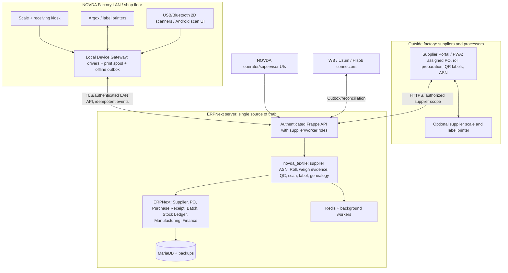
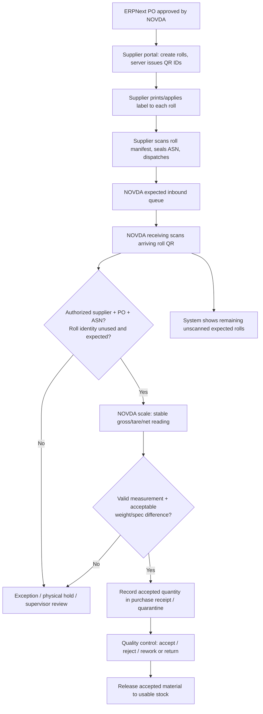

# NOVDA ERP — Architecture & Process Blueprint v0.2 — Supplier-first QR and ASN

**Status:** Design proposal v0.2, not approved implementation specification. Supplier-first receiving added; all tolerance and device decisions are provisional.  
**Date:** 2026-10-11  
**Platform:** ERPNext / Frappe + isolated `novda_textile` custom app + local device gateway.  
**Priority:** Plan processes, identities, transaction invariants, machine integration, and acceptance tests **before code generation**.

## 0. Purpose and scope

An end-to-end, auditable chain starting when NOVDA issues a Purchase Order to a fabric manufacturer, through supplier-side roll pre-registration, QR labeling, pre-shipment ASN and NOVDA scan-and-weigh receipt, then cut bundles, sewing operations, outsourced work, quality inspection, packed product, and marketplace shipment. Track **external suppliers and counterparties**, **physical units**, **business documents**, **monetary costs**, **staff and devices**, and **traceability genealogy**. Do not create a duplicate ERP or duplicate stock ledger. This document is a proposed architecture; the actual device make/model/protocol and workflow tolerances must be validated on site.

Known context: NOVDA apparel/knitwear factory (T-shirts, long sleeves, polos, etc.); 200+ workers; multi-size/multi-color finished goods; subcontract operations; Wildberries and Uzum sales. Existing workers submit work, a supervisor validates it, and accounting currently uses Excel; an existing Hisob project exists. Argox iX4-350 printer was previously mentioned. No scale model, physical receiving station layout, or detailed cutting-bundle size rules have been verified.

## 1. Non-negotiable architecture rules

1. **Single inventory accounting source:** ERPNext's submitted Stock Entry / Purchase Receipt / Delivery Note / Subcontracting records and immutable stock ledger. Custom tables carry physical identity and evidence, not independent monetary stock balances.
2. **Physical identity != SKU != supplier lot:** supplier/dye lot contains many rolls; every roll gets a unique Roll ID; cutting yields Bundle IDs; packing yields Carton IDs; every finished variant has a SKU. IDs are not interchangeable.
3. **Reading a QR only identifies a physical unit.** An operation with an authorized user, target, document and validated quantity changes stock or work status.
4. **Weight readings are evidence; they are not stock movements.** Stock is posted only after a stable calibrated weight, resolved item, lot, tare, anti-duplicate check and authorized receipt rule.
5. **Print after commit:** completed receipts create a durable print job; printer failure cannot create double stock receipts. Reprints are logged.
6. **Every quantity change is traceable and reversible through an authorized compensating document; never delete stock history.**
7. **Production cost and piecework compensation require an approved version of BOM/rate and verified output.** A scan alone never pays a worker.
8. **Device loss or network interruption must not silently corrupt totals.** Queue scans/measurements locally with unique event IDs and controlled sync; no blind replay.
9. **No production credentials in agents. No direct live data edits by autonomous development agents.**
10. **Supplier declaration is not NOVDA acceptance.** Supplier scans/weights create `Expected` ASN records, never NOVDA stock ledger entries or payables by themselves.
11. **NOVDA allocates immutable roll identities before the supplier prints labels.** Supplier cannot invent arbitrary accepted NOVDA QR codes; if external labels are needed, map them to NOVDA-issued identities with supplier-specific uniqueness checks.
12. **Every supplier is isolated:** Supplier A must never query Supplier B documents, rolls, prices or shipments. No general ERP desk access to external partners.
13. **Scan identifies; measured and validated receipt posts stock.** Repeated QR scans, retries and duplicated shipping notices must not book stock twice.
14. **All physical units on inbound transport must be declared before dispatch:** supplier-side roll manifest and container/pallet hierarchy (optional), with versioned snapshots and accountable post-seal amendments.

## 2. Logical system architecture — supplier-first



**External distribution decision:** do not install full ERPNext on supplier PCs or give suppliers the NOVDA ERP Desk. They receive a web-based `NOVDA Partner Portal`, usable from phone or browser. It is part of the `novda_textile` app and uses authenticated Frappe portal APIs. A supplier can only view assigned purchase orders (safe subset), declare prepared rolls, issue labels for those rolls, and create/confirm Advanced Shipping Notices (ASN). They cannot book NOVDA stock, post invoices/payroll, see competitors, change approved PO prices, or create arbitrary trusted labels.

**Implementation boundaries:** ERPNext native objects own accounting and stock; `novda_textile` owns ASN, supplier-issued roll manifests, unique roll identity, device evidence and garment detail. Never modify Frappe/ERPNext core. Pin supported versions. ERPNext's standard backing store is **MariaDB**, not a second bespoke JSON inventory database.

**Device gateways:** local on-site service for actual NOVDA scales/printers; external supplier may enter declared weight manually or connect their own device adapter later. Receiving weigh station is always a separately verified NOVDA measurement. Supplier labels can be printed as PDF, from their printer driver, or via a supported partner print adapter.

## 3. Canonical identities and data model

| Entity | Example ID | Purpose and critical fields | Record owner |
|---|---|---|---|
| Item / Material SKU | FAB-COT-160-WHT | Fabric type, composition, width, nominal GSM, Stock UOM kg | ERPNext Item |
| Supplier / dye lot | LOT-2026-104 | Supplier, mill lot, color, fabric specs, purchase order | ERPNext Batch field or custom `Fabric Lot` association |
| Purchase order | PO-2026-00081 | Authoritative authorized items, specs, accepted UOM, supplier and planned quantities | ERPNext Purchase Order |
| Pre-shipment ASN | ASN-2026-00052 | Supplier, linked PO lines, list of roll IDs, declared weights, logistics units, dispatch status | Custom Supplier ASN (not stock movement) |
| Logistics package/pallet | HU-26-000021 | Optional handling unit, child rolls, shipment and aggregate weights; may additionally use a licensed GS1 SSCC | Custom Handling Unit |
| Physical roll | R-26-000183 | Unique roll, linked lot and batch, initial/current physical state, source parent, last measurement | Custom Roll + ERPNext batch stock |
| Supplier declared weight | SW-26-000500 | Supplier-entered or supplier-device weight; evidence, NOT accepted stock quantity | Custom Supplier Measurement |
| NOVDA weigh event | W-26-000500 | Scale ID, raw stable value, tare, net, unit, timestamp, operator, hash, measurement status | Custom immutable Weigh Event |
| Receipt / movement | PR-... / STE-... | Formal quantities, valuation, warehouses, references | ERPNext |
| Production order | WO-... | Model, color, size mix, BOM version, plan quantities | ERPNext Work Order + custom plan |
| Cut bundle | B-26-000812 | Source rolls, model, size, color, cut part count, target operation, current state | Custom Bundle + genealogy |
| Worker operation | OP-26-... | Bundle, job/operation, employee, submitted qty, verified qty, price version | Job Card + custom piecework event |
| QC event | QC-... | Inspected qty, good / rework / defect / scrap, reason, inspector | ERPNext Quality Inspection + custom details |
| Carton / bag | C-26-000043 | Contents by SKU/batch/qty, weight, sealing, shipping destination | Custom logistic unit + ERPNext Delivery Note |
| Marketplace listing mapping | MP-SKU-... | Internal SKU ↔ marketplace SKU/nmId, warehouse, fulfillment type | Custom connector |
| Label / print job | LP-26-... | ID, template version, printer, status, attempt and reprint audit | Custom label service |

**Identity issuance rule:** NOVDA backend allocates `R-26-...` atomically for an authorized PO line. Supplier cannot submit its own ID as a valid NOVDA Roll ID. Once an ASN is sealed, snapshot its roll content and retain all revisions. If a supplier's existing tags/ERP system must be supported, add `{supplier_id, supplier_roll_code}` as a secondary, unique mapped key. A web search or guessed QR value never authenticates a physical shipment on its own.

**Important roll model decision:** use **kg as fabric Stock UOM**, **ERPNext Batch per physical roll** (allow variable kg) and **supplier/dye lot as a grouping attribute**. Link each custom Roll to its batch and current physical lifecycle. This avoids mapping a variable-weight roll to Serial No (serials typically represent individual stock units). Confirm partial depletion, split/repack, returns, batch reservation and performance with a prototype against the selected ERPNext version before freezing this design. Roll labels show a stable ID; **the weight shown on a label is the weight at print time**, while scanned live weight is queried from the server.

### Identity and genealogy constraints

- One Roll ID is never reused. A split creates child Roll IDs and links to a parent; it does not create fabric mass.
- A bundle may have **more than one contributing source roll**; persist exact source quantities/allocations.
- Parent-child genealogy supports forward trace (bad raw lot → affected bundles/finished cartons) and backward trace (sold SKU/carton → bundles → fabric rolls).
- Internal QR/Code128, GS1 product GTIN, Wildberries/marketplace label, and regulated DataMatrix codes are **separate identities**. An internal QR must not be passed off as a marketplace or mandatory regulatory code.

## 4. Supplier-first procurement → preparation → ASN → receiving

### 4.1 NOVDA issues a purchase order

- Purchasing team creates ERPNext Supplier, Item specification and **Purchase Order** (PO). Define material, color, GSM, width, composition, approved tolerance policy, unit of purchase / stock UOM, planned quantity, delivery conditions, and who may prepare the goods.
- Only selected supplier's portal account sees relevant PO lines and permitted delivery terms. No access to internal costing/margins, payroll or other supplier records.
- The same purchase order can yield **multiple partial ASNs**, multiple truck loads and multiple Purchase Receipts. PO residual quantity is not changed just because an ASN is declared.

### 4.2 Supplier prepares rolls and prints NOVDA-compatible labels

1. Supplier logs into `NOVDA Partner Portal` using their own account (browser/phone; software installation not mandatory).
2. Opens assigned PO and clicks `Prepare shipment`. Selects item/lot, enters or imports roll count and per-roll declared *net* mass, optionally width, meter length, supplier mill roll ID, production/dye lot and photos.
3. Server allocates immutable unique NOVDA Roll IDs for this supplier and PO line. Supplier scans or prints the QR for each roll. QR contains a versioned opaque token/ID, e.g. `NVD:R:26:000183` — not a price, weight or editable business data.
4. Print template shows human-readable roll ID, PO reference, fabric/color, lot, supplier declared weight, QR; other fields are optional and time-stamped because they may later change.
5. Supplier physically applies one label to each roll. Each label is auditable (`ISSUED`, `PRINTED`, `REPRINTED`, `VOIDED`). Reprint does not change ID; conflicting duplicate physical units are isolated for review.
6. Before dispatch, supplier scans all prepared rolls into a **Supplier ASN** (advanced shipping notice), optionally packs them into bundles/pallets/transport units with parent labels, fills vehicle/driver/date/document refs and **confirms dispatch**. ASN is sealed/versioned; later changes require explicit amendment and NOVDA notification.
7. NOVDA sees `Expected Inbound` and can prepare space / goods receipt. ASN submission does **not** create a Purchase Receipt or payable.

### 4.3 NOVDA receiving flow (proposed)



**Suggested reception screen:** left panel `Expected: 80 rolls / 2,000 kg declared`; live rows `Scanned 74`, `Pending 6`, `Variance 2`, `Rejected 1` (all demo numbers). On scan, load declared attributes. Scale streams *NOVDA-measured* net weight, independent of supplier declared weight. Verify fabric identity, PO, ASN, status and configurable tolerance. Authorized posting creates a native ERPNext Purchase Receipt *only once* to quarantine stock, with external roll/measurement links. Whether the item requires a pre-receipt QC inspection must be configured consistently with ERPNext's native Quality Inspection blocking behavior. Quarantine stock is physically separated from usable stock; QC later authorizes release or return.

### 4.4 Illustrative example (not real transaction)

- PO for `2,000 kg black 160 gsm knit`, supplier declares `80 rolls` in `ASN-2026-00052`.
- Roll `R-26-000183`: supplier declares **25.000 kg**; NOVDA scale reads **24.700 kg**. Difference = **−0.300 kg**.
- If signed-off tolerance was **±0.200 kg per roll** (illustrative only), status becomes **WEIGHT_VARIANCE** and no automatic receipt of this roll occurs until authorized resolution. If allowed, received quantity is NOVDA verified **24.700 kg** (or supervisor-approved corrected figure), not automatically the supplier's `25.000 kg`.
- Goods invoice and payment can be matched to accepted receipt quantities under actual commercial terms, with supplier dispute and price difference recorded, rather than trusting declared mass.

### 4.5 Exception and security contracts

| Condition | Required system behavior |
|---|---|
| QR not found | `UNKNOWN_LABEL`, put material on hold, do not invent stock automatically |
| QR from Supplier B on Supplier A ASN | Block; show mismatch; role-scoped investigation |
| Valid QR, ASN not dispatched/sealed | Flag early arrival, approval workflow; no silent stock post |
| Duplicate roll QR on two physical objects | Hold second object; record scan anomaly and photographs; prevent second booking |
| Same roll scanned several times | Idempotent existing receipt/inspection lookup; no double receipt |
| Declared 80 rolls, only 77 arrived | Receive 77 independently, show 3 outstanding; partial delivery and residual PO/ASN |
| Extra unannounced roll | Exception receipt candidate; supplier must amend ASN or NOVDA purchase supervisor approves a linked exception |
| Wrong item, color, lot, width, GSM | Quarantine mismatch; no release until corrected and investigated |
| Broken/missing label | Restricted re-identification process after PO/manifest and physical verification; new label version auditable |
| Supplier portal offline | Prepare shipment in draft locally if needed; no trusted final IDs/ASN until server confirmation, unless pre-allocated signed ID pool is specifically implemented |
| Local NOVDA internet outage | Queue scanned evidence; physical quarantine and pending marker, never fake posted receipts |
| Scale/printer failure | Recovery queue, no phantom receipt or duplicate printing; trace operator intervention |
| Supplier tries to change PO or another company's ASN | API and DB-level authorization denies; security audit logs incident |

### 4.6 Implementation objects and permissions

| Business capability | ERPNext standard | NOVDA custom extension |
|---|---|---|
| Supplier relationship | Supplier + contacts, Portal User | Partner onboarding, authorized supplier scope |
| Contract and authorized quantities | Purchase Order | Supplier-facing PO projection, PO line allocation |
| Supplier production and labels | — | Roll Preparation, Supplier Declared Weight, QR registry, Label Print Job |
| Shipment notice | Not assumed available as a suitable built-in garment ASN | Supplier ASN, ASN Item/Roll rows, shipment manifest, handling units, amendments |
| Receiving and valuation | Purchase Receipt, Batch/Stock Ledger | QR scan sessions, supplier declaration vs receiving evidence, unique linking |
| QC and release | Quality Inspection, Stock Entry/warehouses | Physical roll state machine + discrepancy cases |
| Invoice/payable | Purchase Invoice / accounting | Variance/dispute linkage; do not auto-pay based on supplier ASN |

**Proposed status machines:**

- Roll: `ALLOCATED → PREPARED → ASN_SEALED → IN_TRANSIT → ARRIVED → WEIGHED → QUARANTINE_RECEIVED → QC_RELEASED` OR exception routes `VARIANCE_HOLD / REJECTED / RETURNED / VOIDED`.
- ASN: `DRAFT → SEALED → DISPATCHED → PARTIALLY_RECEIVED → FULLY_RECEIVED / CLOSED_WITH_SHORTAGE`; amendments are versioned, not destructive overwrites.
- Role matrix: Supplier can only read its own assigned PO view and own ASN/rolls, prepare labels, and declare shipment; NOVDA receiving can scan/reweigh/record; QC can approve quality; procurement manager can approve commercial variance; accounting controls invoice/payment. All authorization server-side, including direct API calls.

**External barcode compatibility:** partner should ideally print NOVDA-issued QR using PDF or label template. If supplier uses its own ERP and code format, support approved import/API mapping with external supplier roll ID ↔ internal NOVDA Roll ID, ideally still applying NOVDA-compatible sticker. Shipping pallet/container can use internal handling-unit IDs; if partners require interoperable GS1 logistic labels, model SSCC separately and only claim GS1-compliant IDs when allocated correctly through the relevant GS1 rules.

## 5. Core process maps

### A. Stock transfer / picking
Scan roll → identify current approved state and location → select transfer order + destination → scan location label → weigh partial issue if necessary → ERPNext Stock Entry / Batch bundle → update roll state and genealogy → record actor/time. Simply scanning must not issue inventory.

### B. Cutting and leftovers
Work Order + BOM and cutting plan → reserve approved fabric rolls by kg/batch → issue/transfer to WIP → scan Roll and Work Order → actual kg consumed logged; cut bundles created for size/color/part count → print per-bundle QR → reconcile useful outputs, cutting scrap, remnants and measured variance → usable remnant remains original Roll ID if same physical roll; newly separated remnants get child IDs and labels; create the necessary native stock movement/repack documents. Supervisor handles over-tolerance loss. Do not estimate fabric consumption by number of pieces only.

### C. Sewing, piecework and QC
Scan Bundle at operation station → read route and allowed next step → worker reports completed qty → foreman approves/corrects → approved accepted qty posted against Job Card / operation ledger → use effective piece-rate version for compensation → QC splits accepted, rework, reject and scrap → rework route retains original bundle genealogy and must not double-count wages or finished goods. Existing Hisob payroll consumes **approved summaries only**, not raw unapproved entries.

### D. Subcontract (usluga)
Create subcontract service and supplier warehouse → scan outgoing bundles/materials into a formal Subcontracting Order and Stock Entry → capture shipment ID, supplier, expected returns and price → receive partial finished goods with scan/inspection → post Subcontracting Receipt, wastage/rework/reject → reconcile supplier-held items, disputed discrepancies and payable services. Never treat materials physically held by a contractor as completely consumed before receipt/reconciliation.

### E. Packaging and marketplace dispatch
Complete QC → create finished SKUs by model/color/size and finished lot → scan to pack cartons containing one or multiple SKUs → count units, print carton QR, weigh carton for logistics check → reserve by sales/FBO shipment → pick/verify scans → ERPNext outbound document → asynchronous WB/Uzum shipment and stock mapping → external acknowledgement/reconciliation → returns receive into quarantine with reason and QC. Marketplace inventory and accounting states may differ; preserve `on_hand`, `reserved`, `packed`, `shipped`, `in_transit`, `marketplace_received`, `available_to_sell` distinctly.

## 6. Hardware integration contract

**Scale:** exact model and port settings must be physically inspected. Candidate adapters: serial RS-232, USB virtual COM, TCP/IP, Modbus/industrial protocols when device supports them. Read manufacturer-specific framing and stable flags; do not parse the last random number seen on the port. Gate each measurement on: scale online, stability indication or configurable stability window, valid tare, known unit, non-negative net, calibration check, fresh sequence / read ID, repeat-packet deduplication.

**Scanner:** prefer reliable 2D HID/USB scanner, Android camera as alternate. The browser/mobile app performs context-aware scanning through a single `resolve_label` function. Each stock-changing command includes user, workstation, location, target document, quantity, and idempotency key.

**Label printer:** Argox iX4-350 supports QR, DataMatrix, PPLA/PPLB/PPLZ emulation, and Ethernet/USB/RS-232. Choose the *actual installed* emulation (PPLB previously used), driver and label size based on a physical print/scan proof. Do **not** assume Argox directly accepts ESC/POS; choose printer-native output or a tested OS spool/driver. Printer jobs are outbox events with retry/reprint audit.

**Sample 58×40 mm supplier-issued roll label layout (final size to test):**

```text
┌─────────────────────────────┐
│ NOVDA • SUPPLIER FABRIC    │
│ ███████████   R-26-000183   │
│ ██ QR CODE ██ LOT-2026-104  │
│ ███████████   Cotton White  │
│ Declared: 25 kg W: 180 cm   │
│ ASN: ASN-2026-00052        │
└─────────────────────────────┘
```

Encode only a durable ID such as `NVD:R:26:000183` (with validation/versioning), not editable kilograms/status. Printed weight/status may become stale and should be clearly dated or replaced after material movement.

### Normalized measurement event example

```json
{
  "event_id": "device-01:000029391",
  "station_id": "RECEIVING-01",
  "scale_id": "SCALE-01",
  "captured_at": "2026-10-11T09:12:44+05:00",
  "gross_kg": "24.100",
  "tare_kg": "0.680",
  "net_kg": "23.420",
  "stable": true,
  "calibration_ok": true,
  "protocol": "device-specific",
  "raw_packet_hash": "sha256-...",
  "receipt_session_id": "IN-2026-00012"
}
```

This is an **interface design example**, not a real scale reading or guarantee that a specific scale supports the fields.

## 7. Data integrity, availability, auditing

- **Atomic post:** one authorized operation triggers a native ERP transaction and one evidence link in a DB transaction. Labels and notifications are dispatched *after commit* via outbox/background workers.
- **Idempotency:** `event_id`, `command_id`, `(station, device_sequence)` unique keys. A replay returns previous result; never counts again.
- **Concurrency:** prevent two operators from issuing the same remaining roll kg; transaction-level validations/locking and version check.
- **Offline:** kiosk captures scans/weights with signed event IDs; critical final stock postings are **not assumed complete until server confirmation**. If offline, label indicates provisional/hold; ensure physical quarantine. Reconnect sync resolves ordering and conflicts.
- **Immutable audit:** corrections through reversal/adjustment documents with reason, actor, original event reference; restricted roles, immutable log, backups and restoration tests.
- **Security:** TLS or authenticated LAN tunnel, device-specific keys and RBAC; printer/scales not exposed on Internet. Never grant an overnight coding agent real money, payroll, marketplace write or production permissions.
- **Reconciliation:** `sum(roll batch qty by warehouse) == ERP stock balances` for tracked fabric; `cut accepted + scrap + leftovers == issued` within measured/defined tolerances; `received bundles - defect/rework/loss == accepted output` by operation; `carton contents == dispatch pick list`; no duplicate outward.

## 8. Workstations and roles

| Station | UI primary action | Role | Machine |
|---|---|---|---|
| Supplier dispatch | assigned PO → prepare rolls → QR print → ASN seal | supplier authorized portal user | supplier browser / printer |
| Receiving | scan supplier QR → ASN match → NOVDA scale → quarantine receipt | receiving operator | scale, 2D scanner, optional Argox for re-label |
| QC arrival | inspect sample, accept/reject lot, quarantine release | quality controller | scanner/tablet |
| Raw fabric store | locate, reserve, pick, transfer, count | warehouse clerk | 2D scanner/mobile |
| Cutting | scan rolls, weigh consumed/remnants, create bundles | cutter/foreman | scanner, optional scale, label printer |
| Sewing | scan bundle and station, operation produced quantities | worker/foreman | scanner/tablet |
| In-process QC | good, rework, defect with reasons | OTK | scanner/tablet |
| Subcontract dispatch/return | scan supplier-bound bundles, receive and reconcile | logistics | scanner, scale if necessary |
| Finished goods | SKU intake, carton pack, cycle counts | finished-store clerk | scanner, printer, scale |
| Shipping | scan shipment/cartons, confirm dispatch | dispatcher | scanner/printer |
| Office | approve exceptions, piecework, cost, traceability | finance/manager | desktop |

**UX:** one primary activity per workstation, large buttons, persistent selected task, instant audible/visual scan feedback, clear last operation, fail-stop on duplicate, reconnect banner and pending-event count. Worker/foreman approval pattern is not optional in payroll.

## 9. Phases / release gates (not time estimates)

**Gate 0 — Process discovery:** supplier onboarding, existing labels / supplier printers, purchase ordering & ASN flow, physical receiving observation, equipment inventory, current paper/Excel forms, part counts and tolerances. All decisions/unknowns and approved diagrams in `DECISIONS.md`.

**Gate 1 — Partner and hardware proof:** external supplier logs in with correctly restricted portal scope; prints 50 unique QR labels bound to an authorized PO, issues ASN; NOVDA receives sample using one real scanner, one real scale; gateway handles failure/reprint.

**Gate 2 — Core procurement and stock proof:** ERPNext installed, supplier portal and custom app; supplier-created expected roll is matched by QR/ASN, reweighed by NOVDA, purchase-received into quarantine, QC released, split/partially consumed, returned and reconciled in *native* stock ledger. No JSON substitute.

**Gate 3 — Factory pilot:** one product model, one color, multiple sizes from roll → cutting → sewing → QC → finished SKU, with batch genealogy and approved worker operations.

**Gate 4 — External and financial proof:** one partial subcontract with return/defects/payment; costing; carton shipment; simulated marketplace mappings; then sandbox/write-safe API tests with credentials.

**Gate 5 — Controlled deployment:** real operational training, backup restore, role restrictions, discrepancy dashboard, parallel paper/ERP control and sign-off. No autonomous production switch-on.

## 10. Acceptance and failure tests

| Test case | Pass condition |
|---|---|
| Supplier A sees Supplier B data via API | forbidden (403/permission denied), even with guessed document IDs |
| Supplier labels 80 ordered rolls | all IDs unique, tied to authorized PO, each visible in sealed ASN |
| ASN without goods arriving | no stock posting or supplier invoice approved solely from ASN |
| Scan roll in incoming ASN | resolves exactly one expected supplier/PO/lot/roll and its declaration |
| Unannounced, cloned or wrong supplier QR | hold/exception and zero unauthorized stock movement |
| Partial delivery (77/80 rolls) | 77 linked receipts, 3 ASN roll records still outstanding |
| Supplier vs NOVDA scale mismatch | recorded two weights and auditable approval; no blind overwriting |
| Stable scale reading | precisely one Weigh Event for one accepted capture; raw evidence retained |
| Unstable reading | no submitted receipt or printed usable label |
| Negative tare / unexpected units | rejected with visible reason |
| Device disconnected mid-read | no partial stock transaction, recoverable station |
| Duplicate weigh packet | one physical roll and receipt line, never two |
| Printer off after receipt | valid receipt + queued label; successful authorized reprint |
| Wrong / cloned QR | cannot create unjustified duplicate movement |
| Roll part issue | residual qty is correct and physically identifiable |
| Roll split | each child ID unique; total mass conserved within tolerance |
| Two concurrent pickers | cannot both issue the same roll's residual quantity |
| Blocked QC lot | cannot reach production usable stock |
| Wrong color/size | operation and pick blocked or flagged |
| Operation rework | trace retained; no double wages/output |
| Subcontract partial return | supplier-held remainder and costs reconcile |
| Carton with mixed SKUs | exact per-SKU contents and quantities maintained |
| Marketplace retry | no duplicate export or accidental stock oversell |
| Internet outage | pending events visible and no false success |
| Trace recall | finished carton can be traced back to contributing fabric rolls |
| Reversal | original posted history preserved with signed corrective document |
| ERP backup restore | stock, label and genealogy audit matches baseline |

## 11. Open site facts requiring discovery (not a reason to write guesses into code)

1. Which fabric makers/finishers supply NOVDA? Do they already print roll labels, have a scale/label printer, use their own ERP, and have phone/internet access? (Do not assume all partners can install software.)
2. Who sets purchase quantity unit and accepted weight tolerances (net kg, nominal length, number of rolls) and who is allowed to accept discrepancies?
3. Are rolls shipped directly from a manufacturer, from a dyeing/finishing subcontractor, or via intermediary? Ownership, lot origin and paperwork may differ.
4. Exact scale brand/model, protocol, connection type, stability output, precision, max load, available tare method and calibration/verification process.
5. Roll data: supplier roll tags, composition/GSM, actual widths, unit of purchase/pricing, per-roll return/weighing practice and acceptable variances.
6. Cutting workflow: bundle sizes, marker consumption, multiple-roll mixing, scrap classification, handling of partially used rolls and leftovers.
7. Sewing route: number/type of operations, worker self-report vs automatic scanning, supervisor approval and separate rate versions; interfaces to existing Hisob.
8. Subcontractor operation types: whether fabric, cut parts or semi-finished garments leave; dispatch/return weighing and defect allowances.
9. Finished packaging: individual pack, polybag, box/sack/pallet sizes, carton-level mix rules, WB/Uzum label obligations and existing label templates.
10. Station count and floor network quality; offline duration tolerance; printer model/emulation/media tests; worker roles and permissions.

**Code-generation authorization criterion:** Do not allow a general autonomous agent to implement the full system from this draft alone. Validate Gate 0 and device protocol first, then build the smallest vertical slice against real ERPNext with evidence and pass/fail gates. A development agent may research, document and prototype safe simulated devices meanwhile.

## 12. Reference sources (public docs)

- ERPNext Supplier + Supplier Portal: https://docs.frappe.io/erpnext/supplier and https://docs.frappe.io/erpnext/how-to-create-a-supplier-quotation-through-the-supplier-portal
- ERPNext Purchase Order and Purchase Receipt: https://docs.frappe.io/erpnext/purchase-order and https://docs.frappe.io/erpnext/purchase-receipt
- Frappe portal users/permissions: https://docs.frappe.io/framework/user/en/basics/users-and-permissions and https://docs.frappe.io/framework/user/en/portal-pages
- GS1 logistics units/SSCC context (optional, separate from proprietary roll QR): https://www.gs1.org/standards/gs1-logistic-label-guideline/1-3
- ERPNext stock transactions: https://docs.frappe.io/erpnext/stock-entry
- ERPNext serial/batch bundle: https://docs.frappe.io/erpnext/serial-and-batch-bundle
- ERPNext quality inspection: https://docs.frappe.io/erpnext/user/manual/en/quality-inspection
- ERPNext Work Order and Job Card: https://docs.frappe.io/erpnext/work-order and https://docs.frappe.io/erpnext/job-card
- ERPNext Subcontracting: https://docs.frappe.io/erpnext/subcontracting
- Frappe API and DB transactions: https://docs.frappe.io/framework/user/en/guides/integration/rest_api and https://docs.frappe.io/framework/user/en/api/database
- Frappe printing: https://docs.frappe.io/framework/user/en/printing/raw-and-network-printing
- Argox iX4-350 device specifications: https://www.argox.com/products-detail/ix4-350/
- GS1 QR/DataMatrix distinctions: https://support.gs1.org/support/solutions/articles/43000755322-what-is-the-main-difference-between-qr-code-and-gs1-data-matrix-

**Next deliverable after actual floor verification:** supplier/NOVDA/finance/QC swimlane diagrams, approved BPMN swimlanes, ERPNext vs custom DocType map, physical label specimens, device protocol adapters, exception/state machine, ERPNext transaction mappings, and executable acceptance test specifications. Only then implementation sprint plan / OpenCode prompt.
