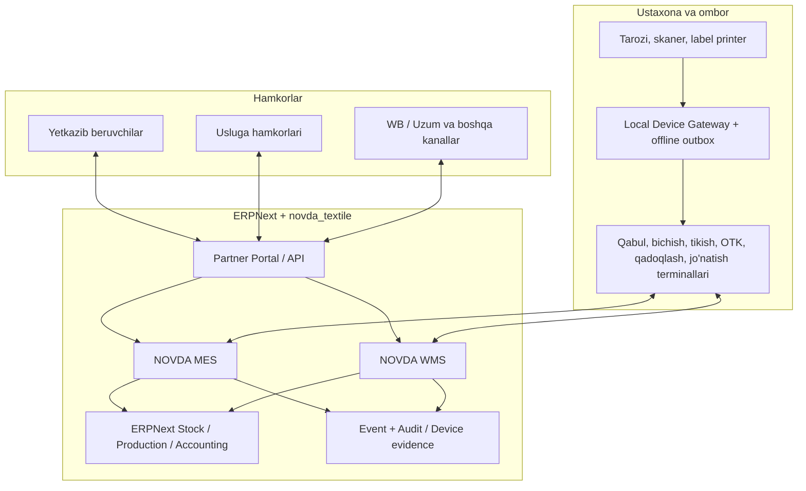

# NOVDA ERP — Enterprise Process Architecture v0.3

**Maqom:** Loyihalash uchun ishchi konsepsiya; implementatsiya topshirig'i emas.  
**Sana:** 2026-10-11  
**Oldingi versiya:** `NOVDA_ERP_BLUEPRINT_v0.2.md` (supplier-first kirim).  
**Maqsad:** Barcha hamkorlar, omborlar, bo'limlar, uslugalar, ishchilar, ishlab chiqarish partiyalari, jo'natmalar va qaytimlar uchun yagona raqamli harakatlar zanjiri.

## 1. Arxitektura tamoyili: fabrikadagi harakat = raqamli isbot + tasdiqlangan hujjat

Har bir jarayon quyidagi umumiy protokoldan foydalanadi:

1. **Trigger** — xarid, reja, transfer, xizmat topshirig'i, jo'natma, qaytim yoki ichki talab.
2. **Fizik identifikatsiya** — QR, shtrix-kod, RFID (faqat zarur bo'lsa), xodim kartasi yoki uskuna ID.
3. **O'lchash/kiritish** — tarozi, hisoblangan dona, hisoblagich, skaner yoki boshqariladigan qo'lda kiritish.
4. **Kontekst** — qaysi buyurtma, liniya, ombor lokatsiyasi, material partiyasi, ishchi, kompaniya va qurilma?
5. **Validatsiya** — miqdor, identifikatsiya, rezerv, oldingi bosqich, ruxsat, sifat, limit, dublikat va vaqt.
6. **Tranzaksiya** — ERPNext'da amaldagi biznes hujjati yoki ishlab chiqarish hodisasi; stok o'zgarishi faqat rasmiy stock hujjati orqali.
7. **Tasdiq + davom** — yangi holat, keyingi mas'ul, kerak bo'lsa yorliq / xabarnoma / ish haqi uchun asos.
8. **Iz** — kim, qachon, qaysi qurilmada, qaysi eski va yangi qiymat, qaysi hujjat; tuzatish revers/adjustment orqali.

**Qoida:** Skaner qilish avtomatik ombor kirimi degani emas; skaner avvalo identifikatsiya. O'qilgan kod tegishli workflow holati, talab qilinadigan o'lchov va rol bilan tasdiqlangandan keyin hujjat yaratiladi. Operator uchun keraksiz bosqichlarni UI o'zi avtomatlashtiradi.

## 2. Tizim chegaralari

- **ERPNext (biznesning yagona hisob manbasi):** Item, Supplier, Customer, Purchase Order, Purchase Receipt, Stock Entry, Batch, Warehouse, Work Order, Job Card, Quality Inspection, Subcontracting Order/Receipt, Delivery Note, accounting va costing. ERPNext stock ledger'ining o'rniga yangi JSON/PostgreSQL qoldiq tizimi qurilmaydi.
- **NOVDA MES custom app:** model/texkarta, kesim rejasi, rulon genealogiyasi, pachka/bundle, operatsiya oqimi, qayta ishlash, tasdiqlangan ishbay natija, ishlab chiqarish tahlili.
- **NOVDA WMS custom app:** QR bilan qabul, lokatsiya, picking, packing, cross-dock, cycle count, yuklash, qaytim va qadoq genealogiyasi.
- **NOVDA Partner Portal:** mato yetkazib beruvchi, bo'yash, bichish, tikish, kashta va boshqa xizmat ko'rsatuvchilar uchun rolga mos cheklangan portal.
- **Device Gateway (mahalliy xizmat):** tarozi RS-232/USB/Ethernet drayverlari, QR skaner oqimi, printer queue va barqaror/offline event outbox.
- **Marketplace Integrations:** WB/Uzum va keyinchalik boshqa kanallar; API adapterlar, mapping, sinxronizatsiya va reconciliation; ombor hisobi adapterlarda saqlanmaydi.
- **Analytics:** ERP va MES/WMS ma'lumotlaridan dashboardlar; hisobot bazasi bo'lishi mumkin, lekin alohida yozib turiladigan stock ledger emas.

### Muhim arxitektura cheklovi

Frappe/ERPNext qo'llab-quvvatlaydigan asosiy ma'lumotlar bazasi va ORM ishlatiladi. Core kod tahrirlanmaydi. Har qanday custom operatsiya native hujjatlarni to'g'ri yaratishi kerak. Muhim harakatlar uchun idempotency key, versiyalangan hujjat holati, serverdagi tranzaksiya va o'zgarmas audit izlari kerak.

## 3. Fizik identifikatorlar — yagona namespace, turli granularlik

| Obyekt | Tavsiya ID | Egasi | QRning vazifasi |
|---|---|---|---|
| Material turi | `FAB-...` | Item master | Faqat SKU, fizik rulon emas |
| Yetkazib beruvchi partiyasi | `LOT-...` | Batch/lot | Kelib chiqish va sifat |
| Rulon | `ROLL-...` | Roll register | Bitta fizik rulonni aniqlash |
| Qolgan rulon/bo'lak | `REM-...` | Parent-child genealogy | Qoldiqning alohida tarixi |
| Bichilgan pachka | `BND-...` | Bundle register | Model, rang, razmer, dona, operatsiya |
| Ish buyurtmasi | `WO-...` | ERPNext | Reja va nazorat, fizik yorliq emas |
| Quti | `CTN-...` | Carton register | Qutidagi SKU/miqdor tarkibi |
| Pallet/yuk birligi | `HU-...` | Handling unit | Bir nechta quti/rulon konteyneri |
| Jo'natma | `SHP-...` | Shipment/Delivery | Transport va jo'natma tarkibi |
| Usluga topshirig'i | `SUB-...` | Subcontract order | Hamkorning vazifasi |
| Xodim kartasi | `EMP-...` | HR/Hisob | Shaxsni aniqlash, operatsiya tasdig'i emas |
| Uskuna | `EQ-...` | Asset | Texnik xizmat va nosozlik |
| Ombor joyi | `LOC-...` | Bin/location | Fizik manzilni tekshirish |

**QR payload:** stabil, opaque ID + versiya/namespace; maxfiy narx, shaxsiy ma'lumot va o'zgaruvchan miqdor joylanmaydi. Vendor kodi mavjud bo'lsa alias mapping saqlanadi. Har bir futbolkani seriallash shart emas: aksar tayyor mahsulot SKU + batch + carton darajasida kuzatiladi; maxsus talabda dona darajasiga tushiladi.

**Genealogy:** Roll -> (cutting batch) -> Bundle -> (operation/QC) -> Finished SKU batch -> Carton -> Handling Unit -> Shipment -> Marketplace. Obyektlarni bo'lish/birlashtirish uchun typed parent-child edge va tekshirilgan quantity/UOM konversiya kerak.

## 4. Ustuvor biznes jarayonlar katalogi

| ID | Jarayon | Fizik signal / kirish | Muhim natija | Tekshiruv |
|---|---|---|---|---|
| P01 | Yetkazib beruvchi ro'yxatdan o'tishi | Partner Portal | Scope berilgan akkaunt | Tenant isolation |
| P02 | Xomashyo xaridi va PO | Tasdiqlangan buyurtma | PO, reja, narx versiyasi | Limit/approval |
| P03 | Yetkazib beruvchi rulon tayyorlashi | Tarozidan/manual declared kg, QR print | ASN + roll manifest | PO bilan moslik |
| P04 | Mashinaga yuklash | Roll/HU skaner | ASN sealed, dispatch | Yetishmayotgan ID |
| P05 | NOVDA qabul darvozasi | ASN/HU QR | Gate check-in | Boshqa yuk, dublikat |
| P06 | Rulon qabul va tortish | QR + stable scale + tare | Tekshirilgan qabul | Ortiqcha/kam kg, kalibrovka |
| P07 | Xomashyo OTK | Lot/Roll QR | Accept/quarantine/reject | Sifat mezoni |
| P08 | Lokatsiyaga joylash | Roll + Bin QR | Putaway va bin holati | Mos keluvchi joy |
| P09 | Mato rezervlash / olish | Work order + roll QR | Pick/transfer | Mavjud saldo |
| P10 | Mato qayta tortish / split | Roll QR + scale | Remnant child ID | Mass balance |
| P11 | Model texkartasi va BOM | Tasdiqlangan spetsifikatsiya | BOM/rassenka versiyasi | Tasdiqlangan revision |
| P12 | Bichish topshirig'i | Work order + marker plan | Cutting job | Model, rang, size mix |
| P13 | Bichish faktini yopish | Roll + cutter + bundle | Sarf, brak, qoldiq, bundle QR | Mass/yield reconciliation |
| P14 | Tikish liniyasiga tarqatish | Bundle + line QR | WIP assignment | To'g'ri stage |
| P15 | Ishchi operatsiyasi | Employee + bundle + operation | Ish bajarganlik hodisasi | Dublikat/limit/qayta hisob |
| P16 | OTK / rework | Bundle/batch QR | Qabul, brak, rework | Rework loop |
| P17 | Dazmol, finishing | Bundle/job QR | Keyingi stage | Bajarilgan prerequisite |
| P18 | Tayyor mahsulotga aylantirish | Bundle -> SKU batches | FG manufacturing receipt | BOM va chiqim nisbatlari |
| P19 | Paketlash | SKU scan + pack job | Unit packaging | Rang/razmer tekshiruv |
| P20 | Qutiga joylash | SKU + carton QR | Carton manifest | Target qty/mix |
| P21 | Quti/pallet transferi | Carton + bin QR | FG lokatsiya | Ikki martalik transfer |
| P22 | Ichki ishlab chiqarishni uslugaga berish | SUB + bundle/roll scan | Uslugadagi WIP | Ikki tomonli dalolatnoma |
| P23 | Uslugada jarayonni yuritish | Partner portal + bundle scan | External progress | Hamkor doirasida ko'rinish |
| P24 | Uslugadan qabul | Return QR + QC | Partial/full receipt, balans | Brak, yo'qotish, xizmat narxi |
| P25 | Marketplace buyurtma/import | WB/Uzum API | Order/reservation | SKU mapping va qayta sync |
| P26 | Marketplace picking | Picklist + Bin/SKU scan | Tayyorlangan buyurtma | Stock reservation |
| P27 | Marketplace quti va shipment | Carton/HU QR | Shipment ASN/Delivery | Label va manifest mosligi |
| P28 | Transportga topshirish | Carrier + shipment QR | Handover evidence | Scan count/duplicate |
| P29 | Marketplace real status | API + reconciliation | Sold, in-transit, return | Non-authoritative data lag |
| P30 | Qaytim qabul | Shipment/SKU QR + inspection | Quarantine/repair/re-stock | Hech qachon avtomatik sellable emas |
| P31 | Inventarizatsiya | Bin/SKU/Roll/Carton scan | Count + approved adjustment | Count vs ledger |
| P32 | Scrap/chqindi realizatsiyasi | Material/lot + weight | Scrap inventory/disposal | Attribution |
| P33 | Xodim ishbay hisob | Approved operation events | Payroll import/settlement | Rate version, reversal |
| P34 | Smena/time attendance | Badge / camera integration | Attendance evidence | Identity confidence |
| P35 | Uskuna ta'miri | Equipment QR | Maintenance work order | Ishlamaslik sababi |
| P36 | Xarajat / tannarx / rentabellik | Approved postings | Cost & profit dashboard | GL reconciliations |
| P37 | Hamkor hisob-kitobi | Approved receipt/service | Payable, claim, settlement | Dual-side confirmations |
| P38 | Qadoq materiallari | Packaging SKU movement | Consumable stock/cost | Usage vs output |
| P39 | Buyurtma ustuvorligi va rejalashtirish | Demand + capacity | Production schedule | Capacity/missing materials |
| P40 | Audit / loss tracking | Event discrepancy | Investigation case | Non-deletable history |

**Qayd:** katalog boshlang'ich minimum; haqiqiy sex walkthrough jarayonida qo'shimcha tarmoqlar va tasdiqlash nuqtalari to'ldiriladi.

## 5. Yetti asosiy end-to-end flow

### FLOW A — Xariddan xomashyo omborigacha
`Demand -> PO -> Supplier Portal -> Roll IDs -> Weigh/Label -> ASN -> Dispatch -> Gate -> Scan + NOVDA Weigh -> QC -> Purchase Receipt (quarantine/accepted as configured) -> Putaway`

**Differensiyalar:** missing ASN, orphan roll, over/under weight, wrong color, wrong GSM, tampered label, parallel receiving, offline scale, print failure. Supplier declared kg hech qachon avtomatik actual kg bo'lmaydi.

### FLOW B — Xomashyodan bichilgan pachkagacha
`Approved Work Order -> Material Reservation -> Picking Roll+Bin -> Cutting station -> Roll consumption -> Remnant/Scrap -> Bundle generation QR -> WIP transfer`

**Invariant:** input material kg = documented consumption + tracked remnant + scrap + toleransli loss; boshqa model/rangga chiqarish uchun alohida tasdiq.

### FLOW C — Bichilgan pachkadan tayyor futbolkagacha
`Bundle pick -> stage assign -> operation scan -> verified quantities -> in-process QC -> rework if needed -> finishing -> final QC -> manufacturing FG posting -> label/pack`

**Invariant:** ishbay to'lov faqat tasdiqlangan output bilan; takroriy skan ishbayni ikki marta ko'paytirmaydi. Bir operatsiya skaniga har doim fizik stok transfer talab qilinmaydi: WIP stage event va native Job Card orasidagi xarita aniq yozilishi kerak.

### FLOW D — Uslugaga berish va qaytarish
`Approved subcontract job -> scan packed input -> handover -> supplier warehouse custody -> partner acceptance -> stage progress -> return ASN -> scan + QC NOVDA -> partial receipt -> reconciliation + service settlement`

**Invariant:** material egasi va fizik custodian ajratiladi; uslugaga ketgan stok darhol sotilgan/yo'qolgan hisoblanmaydi. Qisman qaytish, yaroqsiz va qayta ishlash oqimi alohida.

### FLOW E — Tayyor tovardan marketplace omborigacha
`Approved FG -> SKU+batch+carton -> bin putaway -> marketplace demand/reserve -> picklist -> scan carton contents -> label mapping -> dispatch docs -> carrier handover -> marketplace statuses/reconciliation`

**Invariant:** rezerv fizik chiqim emas, marketplace buyurtmasi har doim sotuv emas, WB/Uzum transportdagi holat alohida bo'lishi kerak. FBO/FBS oqimlari ajratiladi. Bozor SKU/barcode bilan NOVDA ichki QR o'zaro map qilinadi, aralashtirilmaydi.

### FLOW F — Qaytim va teskari logistika
`Return announced -> in transit -> physical receiving scan -> OTK -> restock / repair / writeoff / supplier claim -> stock/accounting reversal -> closed`

**Invariant:** qaytgan tovar to'g'ridan-to'g'ri sellable qoldiqqa qo'shilmaydi; qayta sotish uchun alohida QC.

### FLOW G — Operatsiya, xodim va tannarx
`Approved tech route/rate revision -> employee ID+bundle+operation -> scan event -> supervisor verification -> payable operation ledger -> payroll export / Hisob sync -> reconciliation`

**Invariant:** ishlab chiqarish hisoboti va ish haqi bir-birini tekshiradi; rate revision tarixni orqaga qayta hisoblamaydi; payroll integratsiyasida ikki manba bir xil ishni ikki marta hisoblamaydi.

## 6. Universal workflow engine — qoidalar birlashtiriladi, biznes holatlar ajratiladi

**ProcessDefinition**: trigger, actor roles, input entity types, states, transitions, required measurements, validation set, approval policy, native ERP posting adapter, compensation strategy, offline allowance, timeouts, SLA, audit fields.

**ProcessInstance**: reference document, stage, assigned owner, expected/actual quantities, condition, evidence IDs, exceptions, linked ledger documents.

**PhysicalEvent**: immutable UUID, actor, station, device, device reading evidence, object, source/target location, action, time, sequence/idempotency key, sync status.

**ExecutionResult**: rejected, draft, needs review, posted, compensating/adjusted. `Posted` javobi ERPNext hujjat commit bo'lgandan keyingina qaytariladi.

O'xshash bosqichlar uchun bir xil scanning UI component qo'llanadi, lekin har bir domainning stock va accounting qoidalari **universal generik jadvalga tiqib qo'yilmaydi**. Biznesga xos typed process handlers bo'ladi.

## 7. Minimal kanonik ma'lumotlar modeli

- **Masters:** Item, Item Variant/SKU, UOM, color/size, Material spec/GSM, supplier, customer, subcontractor, worker, operation, rate version, BOM/tech route version, warehouse/bin, device, QC policy, marketplace mapping.
- **Planning:** demand forecast, approved PO, production plan, work order, work allocation, subcontract order, pick/reservation.
- **Physical identity:** lot/batch, roll, remnant, bundle, carton, handling unit, shipment, label print job.
- **Operational records:** supplier ASN, gate pass, weigh event, QC inspection, scan event, stage completion, subcontract acknowledgment, packing manifest, worker production credit, cycle count.
- **ERP postings:** Purchase Receipt, Stock Entry/Stock Ledger, Work Order + Job Card, Subcontracting Receipt, Delivery Note, Sales/ Purchase Invoice, General Ledger.
- **Integration:** connector event, mapping, sync cursor, outbox/inbox, retry/dedupe, reconciliation, conflict.
- **Governance:** authorization, approval, audit log, attachments, exception case, correction/reversal reference.

### Ma'lumotlar oqimining asosi

`PhysicalEvent -> domain validation -> linked ERP transaction (if inventory/accounting-affecting) -> durable outbox -> reporting/integration`

Shu bilan ikki muammo oldi olinadi: skan serverga qayta yuborilganda ikki marta kirim bo'lishi va hisobotdagi qoldiq bilan ERPNext Stock Ledger ajralib ketishi.

## 8. Station UI — kim nimani ko'radi?

| Rol | UI rejimi | Asosiy tugma/harakat |
|---|---|---|
| Supplier | Partner PWA | PO, roll tayyorlash, QR chop, ASN jo'natish |
| Gate guard | Gate kiosk | Mashina/ASN QR, kelgan jo'natma |
| Omborchi | Receiving & location scanner | Scan -> weigh -> receive -> putaway |
| Bichuvchi | Cutting terminal | Work order/roll -> consumption -> bundles/remnant |
| Tikuvchi | Fast-operation scanner | Employee/bundle/operation -> submit |
| Master | Supervisor tablet | Vazifa, stage, exception, ishbay tasdiq |
| OTK | Inspection terminal | Accept/rework/reject; photo evidence |
| Usluga hamkori | Partner PWA | Handover, progress, partial return, manifest |
| Qadoqlovchi | Packing scanner | SKU/size validation -> carton sealing |
| Logist | Loading scanner | Shipment -> handling unit -> handover |
| Marketplace operator | Connector dashboard | Mapping, reserve, sync errors, reconciliation |
| Hisobchi | Finance & payroll | Settlement, variances, approved wage runs |
| Rahbar | Operations cockpit | End-to-end WIP, stock, cost, bottlenecks, alerts |
| Texnik | Maintenance scan | Equipment ID -> repair tasks/history |

**UX qoidasi:** kiosk interfeys sensorli, katta holat indikatorli, asosiy operatsiyada 2–3 actiondan ko'p talab qilmasligi maqsad; confirmation faqat exception yoki pulga ta'sir qiluvchi actionda ko'rsatiladi.

## 9. Universal exception strategiyasi

1. Offline skan: lokal outboxga faqat tekshiriladigan signed/UUID event; serverga bormagan amal **posted** deb ko'rsatilmaydi.
2. Bir kod ikki marta skan: business operation ID + idempotency key; duplicate ko'rinishi mumkin, posted duplicate yo'q.
3. Printer xatosi: eski kod o'zgarmaydi, print job qayta chiqadi; reprint iziga sabab kiritiladi.
4. O'lchov xatosi: stable reading + tare/calibration check; operator o'zgartirgan kg alohida override va ruxsatga muhtoj.
5. Noto'g'ri/yo'qolgan QR: label recovery + reprint; original ID bekor qilinmasdan history saqlanadi.
6. Qoldiq yetishmasligi: flow blocked, negative stock bilan jim hal qilinmaydi.
7. Handover dispute: yuboruvchi va qabul qiluvchi hujjatlari, discrepancy claim, ikki tomon imzo/evidence.
8. Qisman bajarish/qabul: remaining quantity alohida ochiq turadi; butun order avtomatik yopilmaydi.
9. Wrong item/location/stage: hard block yoki aniq authorized re-route.
10. Tuzatish: hujjatni tarixdan o'chirish emas, approved reverse/adjustment.
11. Integratsiya konfliktlari: API status/tovar qoldiqlari reconciliation; tashqi marketplace statusi ERP omborini bevosita o'zgartira olmaydi.
12. Access: role, supplier scoping, dual approval for high-risk and financial operations; audit append-only.

## 10. Eng zarur sakkizta qaror (hozircha taxmin qilinmasin)

- Qaysi materiallar kg, metr, dona yoki ikki birlikda yuritiladi? Mato eni, GSM, qoldiq turlari qanday?
- Real tarozi modellari/protokollari, zavodda LAN va Wi-Fi qamrovi, printerlar soni, skaner turi?
- Bichishda fizik bundle minimal birligi: model/rang/razmerning nechta detali, defekt va qoldiq accounting?
- Usluga variantlari: to'liq mahsulot, operatsiya yoki bichish materialidan boshlab; ikki tomon material egasi kim?
- Ishbay rassenka va ishlab chiqarishdagi sifat/miqdor tasdig'ini kim va qaysi bosqichda beradi?
- Hisob dasturi bilan aloqa: worker master, payroll owner va takroriy yozuvlarni oldini olish usuli?
- Har bir marketplace FBO/FBS operatsiyasida tovar qaysi nuqtada ombordan chiqdi, rezerv bo'ldi, sotildi va qaytdi?
- Mahalliy uzilishda majburiy ishlash muddati va qaysi operatsiyalar offline ruxsat etiladi?

Bu savollar kodlashdan avval zavoddagi jarayonni kuzatish, bo'lim boshliqlari bilan suhbat va qurilma testidan keyin qat'iy belgilanadi. Vaqtinchalik defaultlar hujjatda ochiq yoziladi, haqiqiy stock posting uchun yashirin taxmin ishlatilmaydi.

## 11. Dizayn bosqichlari va qat'iy quality gate'lar

1. **Process discovery:** 40 jarayondan har birining current-state va target-state flowi, actor, exception, KPI yozilsin.
2. **Canonical entity model:** Roll/Bundle/Carton/Shipment genealogy va native ERPNext hujjatlariga mapping; takroriy entity yaratmaslik.
3. **State machines & access:** qaysi role qaysi holatdan qaysisiga o'tkazadi; dual approval, offline cheklov.
4. **Device contracts:** har bir uskuna uchun exact serial/TCP protokol va test harness; printer label format, readback.
5. **UX prototype:** rol bo'yicha ekranlar, xatolik xabarlari, 2D scanner keyboard wedge va kamerali scan variantlari.
6. **Accounting mapping:** material valuation, WIP, subcontract custody, payroll credits, return/reversal, marketplace channel reconciliation.
7. **Vertical slice:** real ERPNextda PO -> Supplier QR -> Receive -> Cut -> Sew -> QC -> FG -> Pack -> Ship -> Return, plus subcontract detour va cycle count.
8. **Evidence gates:** test orqali asl ERPNext hujjatlari, stock ledger va signed audit izlari tekshirilmaguncha `DONE` emas.

Kodlashni boshlashdan oldin 1–6 bosqich uchun reviewable design artifact bo'lishi kerak; agent dizaynni mustaqil ishlab chiqishi mumkin, lekin real money/stock ma'lumotlarini o'zgartirishga avtomatik ruxsat berilmaydi.

## 12. Muhim reference bazasi

- ISA-95 ishlab chiqarish va biznes tizimlari o'rtasidagi interfeys: https://www.isa.org/standards-and-publications/isa-standards/isa-95-standard
- ERPNext Work Order: https://docs.frappe.io/erpnext/work-order
- ERPNext Job Card: https://docs.frappe.io/erpnext/job-card
- ERPNext Stock Entry: https://docs.frappe.io/erpnext/stock-entry
- ERPNext Subcontracting: https://docs.frappe.io/erpnext/subcontracting
- ERPNext Quality Inspection: https://docs.frappe.io/erpnext/quality-inspection
- ERPNext Serial & Batch: https://docs.frappe.io/erpnext/serial-and-batch

**Izoh:** bu biznes arxitekturasi. Keltirilgan jarayonlar NOVDA uchun taklif qilingan target-state dizayndir; aynan shunday real jarayon ishlab turgani yoki barcha ERPNext custom mapping tayyorligi da'vo qilinmaydi.
